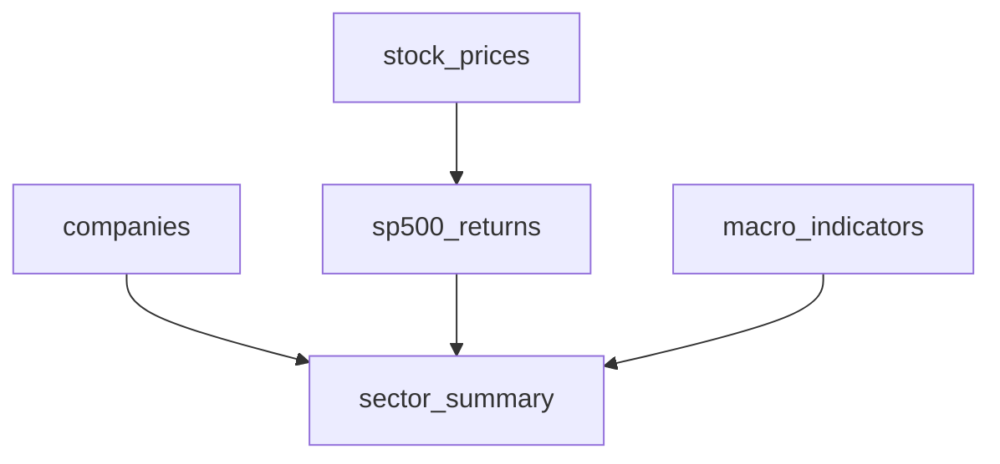

# S&P 500 Sector Returns × Macroeconomic Conditions | SQL Research Database

**Research database & reproducible workflow — DATA 521, Database Development for Public Health (Emory University)**  
**Course project authors:** Conglin Bao (Franklin) and Zirui Chen

A relational-data project studying how **sector-level intraday stock returns** co-move with U.S. macroeconomic conditions, including the federal funds rate, CPI and the VIX. The original coursework used MySQL / DBeaver to combine Kaggle stock prices, S&P 500 company metadata, and FRED indicators. This portfolio release adds a **portable SQLite runner, SQL analytics, an offline synthetic demo and unit tests**.

> **Scope:** This is descriptive historical data analysis, not causal identification, real-time research, or evidence of profitable trading signals. Synthetic examples are clearly separated from the historical course work.

## What this project demonstrates

- **Relational database design:** source/derived table separation, ticker/date joins, keys, uniqueness constraints and indexes.
- **SQL:** DDL, `JOIN`, `GROUP BY`, `AVG`, `COUNT(DISTINCT)`, conditional logic, sector-level aggregation and data-integrity checks.
- **Financial-data ETL:** clean stock/constituent/macro source files and align daily records while preserving a documented definition of return.
- **Research reproducibility:** staged SQL transformations, reproducible demo inputs, a CLI, automated validation and GitHub Actions checks.
- **Communication:** an original 16-slide research presentation documenting the research question, database design, source data and assumptions (course presentation retained outside this code-only release).

## Quick start — works offline, no Docker or MySQL required

```bash
git clone https://github.com/RichardFranklinBAO/SP500-Macro-SQL-Research-Database.git
cd SP500-Macro-SQL-Research-Database
python3 src/build_database.py --demo --db outputs/demo.sqlite
python3 -m unittest discover -s tests -v
```

No third-party Python packages are required. Open `outputs/demo.sqlite` in DBeaver or SQLite Browser, or run the queries in [`sql/03_analysis.sql`](sql/03_analysis.sql).

**Demo dataset:** 3 *fictional* tickers × 3 dates; synthetic macro values. Never interpret demo output as historical economic evidence.

## Reproduce the full historical coursework results

1. Obtain the real CSVs from the sources described in [`docs/data-sources.md`](docs/data-sources.md).
2. Put these **locally** in `data/raw/`: `all_stocks_5yr.csv`, `sp500_companies.csv`, `macro_indicators.csv`.
3. Run:

```bash
python3 src/build_database.py --data-dir data/raw --db outputs/full.sqlite
# Optional: compare against the original exported sector_summary CSV
python3 src/build_database.py --data-dir data/raw --db outputs/full.sqlite --overwrite --reference /path/to/sector_summary_202604301759.csv
```

### Independently verified against the original coursework export

The repository preparation used the original user-supplied historical files. Recomputed sector-day records matched the saved course results with floating-point tolerance `1e-9`:

| Validation | Observed |
|---|---:|
| Raw stock-price observations | 619,040 |
| Stock tickers in raw file | 505 |
| Company metadata entries | 503 |
| Macro indicator dates | 1,350 |
| Returned sector-day observations | **13,849** |
| Sector-day key/value differences | **0** (tolerance `1e-9`) |

This verifies the **original transformation and aggregation**, not the research claim of predictive or causal effects.

## Five-table architecture



`daily_return = (close - open) / open` on valid trading-day stock records. The original project used INNER JOIN on ticker and date, then equal-weighted sector aggregation.

## Repository structure

```text
sql/                    SQLite schema, transformations, and analysis queries
src/build_database.py   Imports CSV sources, builds database, validates original export
original_coursework/    Original co-authored DATA 521 MySQL source code
data/demo/              Synthetic data for fully offline demonstration
data/raw/README.md      Instructions for real input CSVs (ignored by Git)
tests/                  End-to-end data-integrity unit test
.github/workflows/      Automated synthetic-data smoke test
docs/                   Research limitations and source/license notes
```

## Research limitations & responsible sharing

The `sp500_companies.csv` snapshot differs from a historical index membership database; analyses may suffer survivorship bias. Monthly macro inputs are forward-filled to match daily prices and are **not necessarily point-in-time available**; same-day associations do not establish causality. Clinical data are unrelated to this project. The course CSVs are **not bundled**, notably FRED-served VIX data with potential third-party restrictions. See [`docs/methodology.md`](docs/methodology.md).

## Attribution

**Original DATA 521 team project:** Conglin Bao (Franklin) and Zirui Chen, Emory University (2026). The modernization and packaging for a reproducible GitHub research portfolio is credited separately from the original team project. No license is granted for third-party datasets.